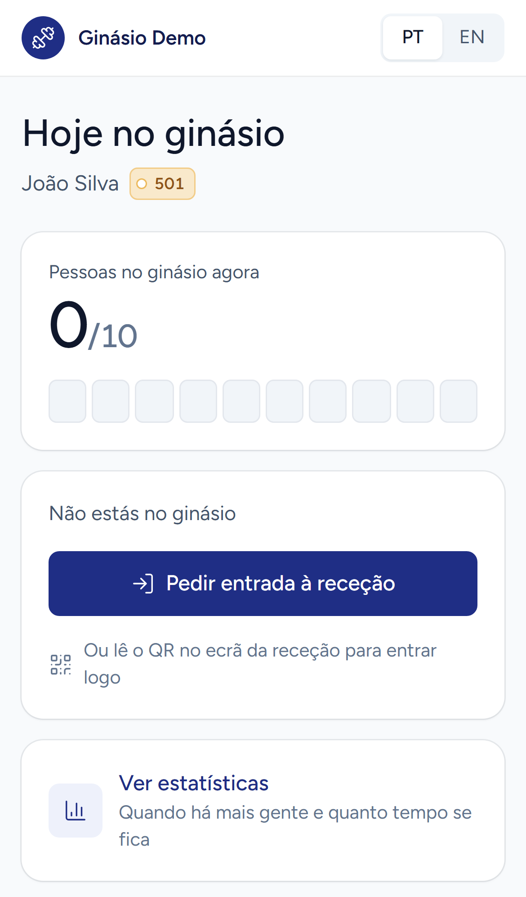
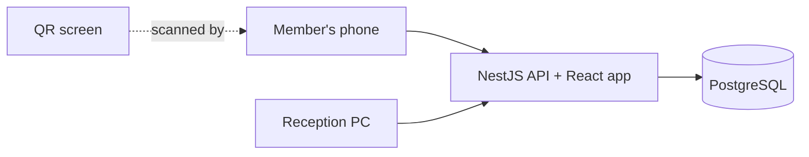

# gym-checkin

**English** · [Português](README.pt.md)

A gym check-in app for **Demo Gym**, a fictional gym made up for this learning and portfolio project: know how full the gym is before you go, and check in and out from your phone.

**Demo:** <https://gym-checkin-pjyi.onrender.com> (fake data; the first load may take a few seconds)

| Role | Username | Password |
| --- | --- | --- |
| Member | `joaosilva` | `estudante-demo` |
| Reception | `rececao` | `rececao-demo` |

| Member (phone) | Statistics (phone) |
| --- | --- |
|  |  |

| Reception desk (PC) | QR screen at reception |
| --- | --- |
|  |  |

## Why

At the fictional Demo Gym, you pick up the key at reception and fill in a paper sheet. The gym is small, and there is no way to know how many people are there before you arrive. The paper sheet is also useless for statistics.

## What it does

- **See how many people are in the gym right now**, live, from your phone.
- **Check in** by scanning the QR code on the reception screen, or by asking reception to accept you. A photo of the QR does not work from home: the code changes every 30 seconds.
- **Check out** with one tap. Forgotten check-outs are closed automatically.
- **See when it is quietest**: a typical day, the busiest hours of each weekday and the best time to go today.
- **Reception** accepts requests, sees who is inside and today's visits on a timeline, and fixes wrong times.
- **Works like an app** on the phone (installable), in Portuguese and English.

## For developers

- **Rules in the database:** "one open visit per person" is a unique index, safe even with two requests at once.
- **Fair statistics:** each visit counts by the time actually spent inside, in Lisbon time, daylight saving days included.
- **Privacy by design:** members only see counts, never who was there ([security and privacy](docs/security-and-privacy.md)).
- **Tested end to end:** every pull request starts the whole app in Docker and a browser runs the main flow.
- **Accessible:** large touch targets, WCAG AA contrast, keyboard navigation, a Storybook story for every screen part.



React + Vite + Tailwind, NestJS + Prisma, PostgreSQL, zod schemas shared by both, pnpm monorepo.

## Try it on your computer

With [Docker](https://docs.docker.com/get-docker/):

```bash
docker compose up
```

Open <http://localhost:3000> and log in with the accounts above (local admin: `admin` / `admin-local-only`). It comes with 90 days of fake visits, so the statistics are full.

## Development

Requirements: Node 24 and pnpm.

```bash
pnpm install
pnpm --filter @gym-checkin/shared build
cp apps/api/.env.example apps/api/.env   # fill in DATABASE_URL, JWT_SECRET, QR_SECRET, SEED_*
pnpm --filter api exec prisma migrate deploy
pnpm --filter api db:seed                # the accounts above
pnpm --filter api db:seed-demo           # optional: 90 days of fake visits
pnpm --filter api start:dev              # API: http://localhost:3000/api
pnpm --filter web dev                    # app: http://localhost:5173
```

Checks: `pnpm lint`, `pnpm test` and `pnpm build` in each package, `pnpm storybook` and `pnpm e2e` in `apps/web`. CI runs them on every pull request.

## Documentation

- [API docs](https://gym-checkin-pjyi.onrender.com/api/docs) (interactive)
- [Security and privacy](docs/security-and-privacy.md)
- [Roadmap](ROADMAP.md) (in Portuguese)

## License

This project is licensed under the [MIT License](LICENSE).
