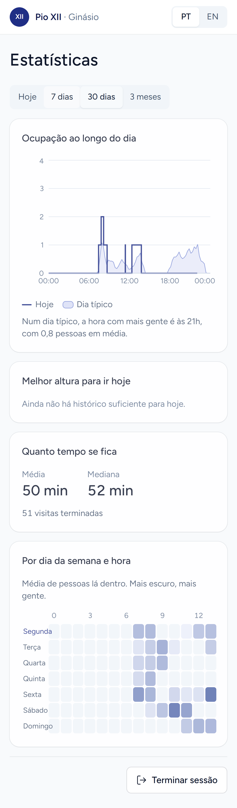
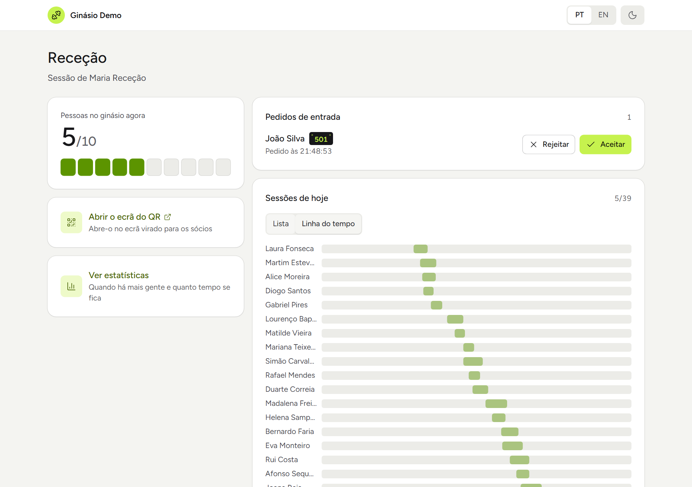
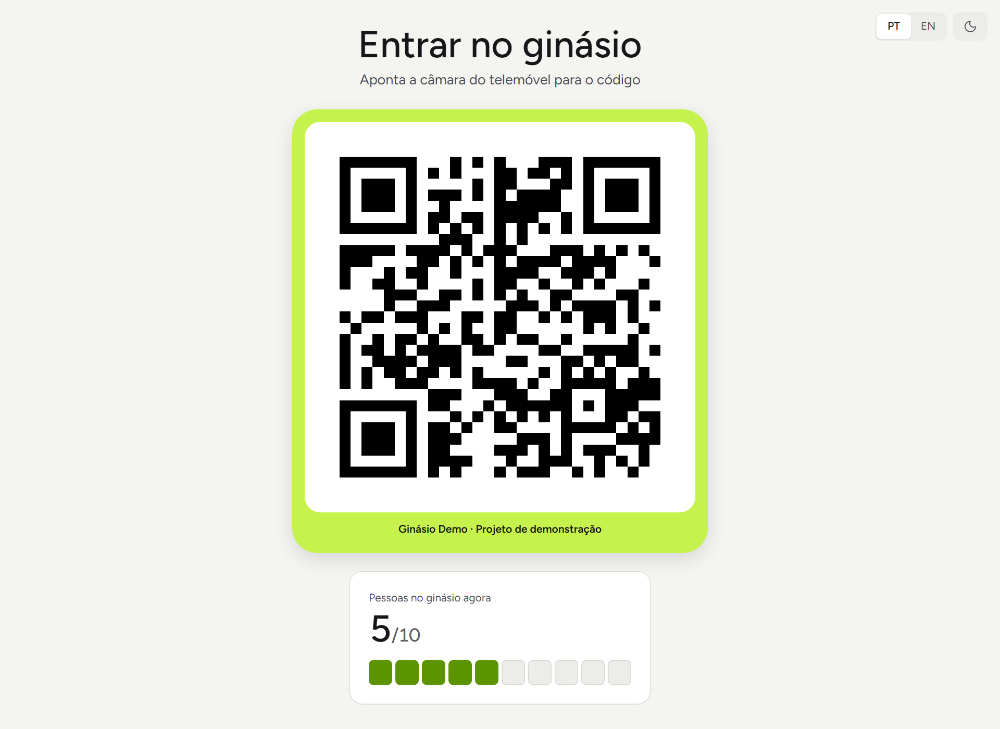
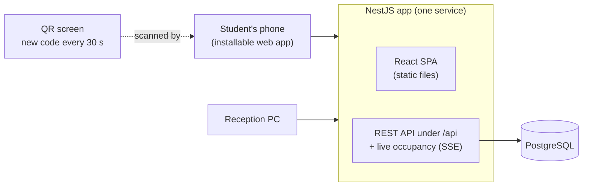

# gym-checkin

**English** · [Português](README.pt.md)

Gym check-in for the PIO XII student residence: students check in and out of the gym from their phone, reception sees who is inside, and everyone can see how full the gym is right now and when it is quietest.

**Demo:** <https://gym-checkin-pjyi.onrender.com> (fake data only; the first response may be slow while the service wakes up)

| Role | Username | Password | Try |
| --- | --- | --- | --- |
| Student | `joaosilva` | `estudante-demo` | ask to enter, scan the QR, leave, see the statistics (on a phone) |
| Reception | `rececao` | `rececao-demo` | accept requests, today's timeline, open the QR screen (on a PC) |

The demo accounts cannot change their password; the admin account is private.

| Student (phone) | Statistics (phone) |
| --- | --- |
|  |  |

| Reception desk (PC) | QR screen (faces the students) |
| --- | --- |
|  |  |

## The problem

To use the residence gym you pick up the key at reception, fill in a paper sheet (name, room, signature, entry and exit times) and hand the key back at the end. The gym is small, and there is no way to know how many people are there before walking down; the paper sheet is useless for statistics. A QR code printed on the wall would not fix it either: anyone can photograph it and "check in" from their room.

## How it works



Proving that a student is really there is a swappable component (Strategy pattern), so the residence turns on the methods it wants:

- **Rotating QR on a screen:** the code is an HMAC of the current 30-second window, so a photo of it expires in about a minute.
- **Reception approval:** the student asks to enter and a person at the desk accepts; the request expires after 2 minutes.

Leaving needs no proof. Visits left open (a forgotten key) are closed by a job and marked `AUTO`, so they never distort the statistics.

## Highlights

- **Rules live in the database, not only in the code.** "One open visit per person" is a partial unique index, so it holds even under two simultaneous requests.
- **Time-weighted statistics.** Occupancy is averaged per 15-minute interval by the time each person was actually inside: leaving at 18:01 adds 1/15 of a person to 18:00, not a whole one. A typical day, a weekday × hour heatmap and the average/median visit length, for today, 7, 30 or 90 days.
- **Today vs a typical day.** Today is an exact step line (a step at every entry and exit) drawn over the typical day, plus the quietest hours still ahead today from that weekday's history.
- **Local time done right.** Statistics group by Lisbon time without a date library; the daylight saving days (23 or 25 hours) are covered by tests.
- **Privacy by design.** Students only see aggregates; the statistics query reads entry and exit times, never who. Reception, who already sees names, gets today as a timeline with one bar per visit.
- **Tested end to end.** Every pull request builds the Docker image, starts the app with a real PostgreSQL and runs a browser through the main flow: a student asks to enter, reception accepts, the count goes up, the student leaves.
- **Phone first and accessible.** Installable (PWA), 44 px touch targets, WCAG AA contrast, keyboard focus everywhere, Portuguese and English. The charts library loads only when someone opens the statistics.

## Try it in one minute

With [Docker](https://docs.docker.com/get-docker/) installed:

```bash
docker compose up
```

Then open <http://localhost:3000> and log in with the accounts above. The app and a PostgreSQL start together, the migrations run, and 90 days of fake visits are created, so the statistics are full from the start. Local admin account: `admin` / `admin-local-only`.

## Development

Requirements: Node 24 (see `.node-version`) and pnpm (version in `packageManager` in `package.json`).

```bash
pnpm install
pnpm --filter @gym-checkin/shared build   # API and web import its compiled output
cp apps/api/.env.example apps/api/.env   # fill in DATABASE_URL, JWT_SECRET, QR_SECRET and SEED_*
pnpm --filter api exec prisma migrate deploy
pnpm --filter api db:seed                # the accounts above (passwords from SEED_*)
pnpm --filter api db:seed-demo           # optional: 15 fake residents, 90 days of visits
pnpm --filter api start:dev              # API at http://localhost:3000/api
pnpm --filter web dev                    # site at http://localhost:5173
```

| Check | Where | Command |
| --- | --- | --- |
| Lint, unit tests (Vitest), build | `apps/api`, `apps/web`, `packages/shared` | `pnpm lint`, `pnpm test`, `pnpm build` |
| Component stories, with accessibility checks | `apps/web` | `pnpm storybook` |
| End to end (Playwright) | `apps/web`, app running | `pnpm e2e` |

CI runs all of them on every pull request (Storybook as a build; its accessibility checks run when you open it).

## Documentation

- **API:** interactive docs at [`/api/docs`](https://gym-checkin-pjyi.onrender.com/api/docs), generated from the same zod schemas that validate the requests.
- **Security and privacy (GDPR):** [docs/security-and-privacy.md](docs/security-and-privacy.md), including the known gaps.
- **Plan and phase status:** [ROADMAP.md](ROADMAP.md) (in Portuguese).

## Stack

React + Vite + Tailwind (`apps/web`), NestJS + Prisma (`apps/api`), PostgreSQL, zod schemas shared by both (`packages/shared`), pnpm monorepo.

| Environment | Runs on | Database |
| --- | --- | --- |
| Development | local machine | Neon, `development` branch |
| Demo | Render (auto-deploy on every merge to `main`) | Neon, `production` branch |
| Try it | `docker compose up` | local PostgreSQL container |
