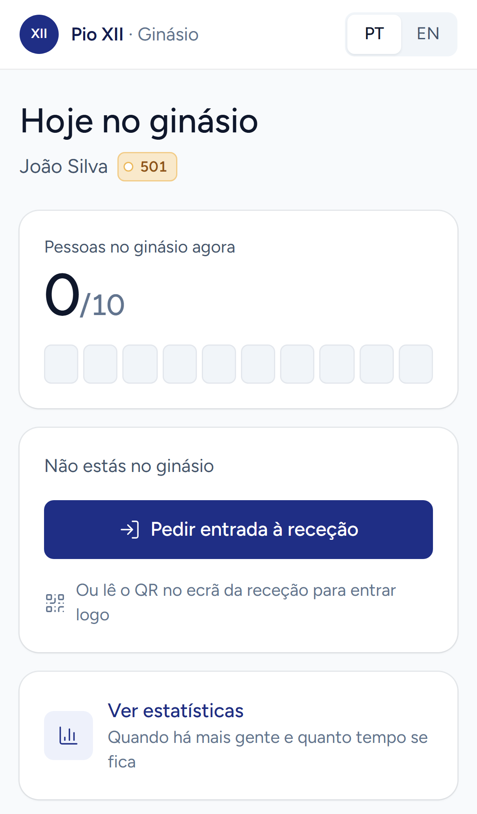
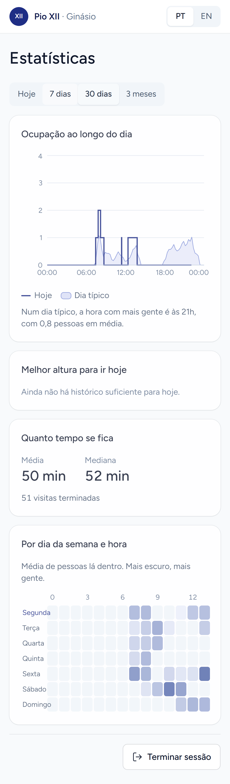
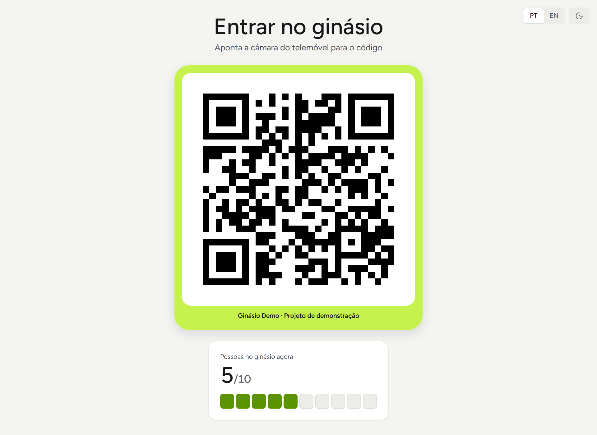
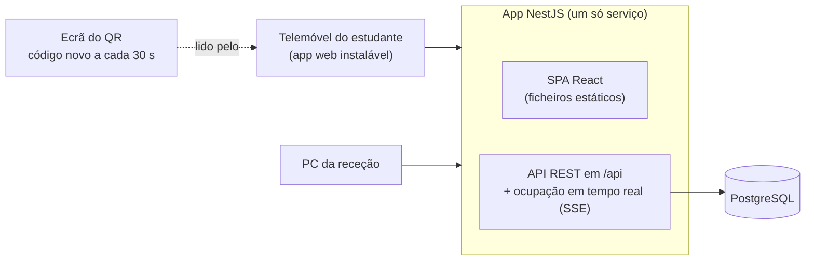

# gym-checkin

[English](README.md) · **Português**

Check-in do ginásio da residência PIO XII: os estudantes entram e saem do ginásio pelo telemóvel, a receção vê quem está lá dentro, e toda a gente vê quão cheio está o ginásio agora e quando está mais calmo.

**Demo:** <https://gym-checkin-pjyi.onrender.com> (só dados falsos; a primeira resposta pode demorar enquanto o serviço acorda)

| Role | Username | Password | Experimentar |
| --- | --- | --- | --- |
| Estudante | `joaosilva` | `estudante-demo` | pedir entrada, ler o QR, sair, ver as estatísticas (no telemóvel) |
| Receção | `rececao` | `rececao-demo` | aceitar pedidos, linha do tempo de hoje, abrir o ecrã do QR (no PC) |

As contas de demonstração não podem mudar a password; a conta de admin é privada.

| Estudante (telemóvel) | Estatísticas (telemóvel) |
| --- | --- |
|  |  |

| Balcão da receção (PC) | Ecrã do QR (virado para os estudantes) |
| --- | --- |
|  |  |

## O problema

Para treinar no ginásio da residência é preciso ir buscar a chave à receção, preencher uma folha em papel (nome, quarto, assinatura, horas de entrada e saída) e devolver a chave no fim. O ginásio é pequeno e não há forma de saber quantas pessoas lá estão antes de descer; a folha em papel não serve para estatísticas. Um QR impresso na parede também não resolvia: qualquer pessoa lhe tira uma foto e faz "check-in" do quarto.

## Como funciona



Provar que o estudante está mesmo lá é um componente trocável (padrão Strategy), por isso a residência ativa os métodos que quiser:

- **QR rotativo num ecrã:** o código é um HMAC da janela de 30 segundos atual, por isso uma foto dele expira em cerca de um minuto.
- **Aprovação da receção:** o estudante pede para entrar e uma pessoa ao balcão aceita; o pedido expira ao fim de 2 minutos.

Sair não precisa de prova. As visitas que ficam abertas (uma chave esquecida) são fechadas por uma tarefa e marcadas `AUTO`, para nunca deturparem as estatísticas.

## Destaques

- **As regras vivem na base de dados, não só no código.** "Uma visita aberta por pessoa" é um índice único parcial, por isso vale mesmo com dois pedidos ao mesmo tempo.
- **Estatísticas ponderadas pelo tempo.** A ocupação é a média por intervalo de 15 minutos, pesada pelo tempo que cada pessoa lá esteve: sair às 18:01 soma 1/15 de pessoa às 18:00, não uma inteira. Dia típico, heatmap dia da semana × hora e duração média/mediana das visitas, para hoje, 7, 30 ou 90 dias.
- **Hoje vs um dia típico.** Hoje é uma linha em degraus exata (um degrau em cada entrada e saída) desenhada por cima do dia típico, mais as horas com menos gente que ainda faltam hoje, pelo histórico desse dia da semana.
- **Hora local bem feita.** As estatísticas agrupam pela hora de Lisboa sem biblioteca de datas; os dias da mudança de hora (23 ou 25 horas) estão cobertos por testes.
- **Privacidade desde o desenho.** Os estudantes só veem agregados; a consulta das estatísticas lê as horas de entrada e saída, nunca quem. A receção, que já vê os nomes, tem o dia de hoje numa linha do tempo, com uma barra por visita.
- **Testado de ponta a ponta.** Cada pull request constrói a imagem Docker, arranca a app com uma PostgreSQL verdadeira e põe um browser a fazer o fluxo principal: um estudante pede para entrar, a receção aceita, a contagem sobe, o estudante sai.
- **Telemóvel primeiro e acessível.** Instalável (PWA), áreas de toque de 44 px, contraste WCAG AA, foco de teclado em todo o lado, português e inglês. A biblioteca de gráficos só carrega quando alguém abre as estatísticas.

## Experimentar num minuto

Com o [Docker](https://docs.docker.com/get-docker/) instalado:

```bash
docker compose up
```

Depois abre <http://localhost:3000> e entra com as contas acima. A app e uma PostgreSQL arrancam juntas, as migrações correm e são criados 90 dias de visitas falsas, por isso as estatísticas aparecem cheias logo de início. Conta de admin local: `admin` / `admin-local-only`.

## Desenvolvimento

Requisitos: Node 24 (ver `.node-version`) e pnpm (versão em `packageManager` no `package.json`).

```bash
pnpm install
pnpm --filter @gym-checkin/shared build   # a API e o web importam o resultado compilado
cp apps/api/.env.example apps/api/.env   # preencher DATABASE_URL, JWT_SECRET, QR_SECRET e SEED_*
pnpm --filter api exec prisma migrate deploy
pnpm --filter api db:seed                # as contas acima (passwords dos SEED_*)
pnpm --filter api db:seed-demo           # opcional: 15 residentes falsos, 90 dias de visitas
pnpm --filter api start:dev              # API em http://localhost:3000/api
pnpm --filter web dev                    # site em http://localhost:5173
```

| Verificação | Onde | Comando |
| --- | --- | --- |
| Lint, testes unitários (Vitest), build | `apps/api`, `apps/web`, `packages/shared` | `pnpm lint`, `pnpm test`, `pnpm build` |
| Stories dos componentes, com verificações de acessibilidade | `apps/web` | `pnpm storybook` |
| Ponta a ponta (Playwright) | `apps/web`, com a app a correr | `pnpm e2e` |

O CI corre tudo em cada pull request (o Storybook como build; as verificações de acessibilidade correm quando o abres).

## Documentação

- **API:** documentação interativa em [`/api/docs`](https://gym-checkin-pjyi.onrender.com/api/docs), gerada a partir dos mesmos schemas zod que validam os pedidos.
- **Segurança e privacidade (RGPD):** [docs/seguranca-e-privacidade.md](docs/seguranca-e-privacidade.md), incluindo as falhas conhecidas.
- **Plano e estado das fases:** [ROADMAP.md](ROADMAP.md).

## Stack

React + Vite + Tailwind (`apps/web`), NestJS + Prisma (`apps/api`), PostgreSQL, schemas zod partilhados pelos dois (`packages/shared`), monorepo com pnpm.

| Ambiente | Corre em | Base de dados |
| --- | --- | --- |
| Desenvolvimento | máquina local | Neon, branch `development` |
| Demo | Render (deploy automático a cada merge no `main`) | Neon, branch `production` |
| Experimentar | `docker compose up` | contentor PostgreSQL local |
