# gym-checkin

[](https://github.com/barrosw5/gym-checkin/actions/workflows/ci.yml)
[](https://github.com/barrosw5/gym-checkin/actions/workflows/codeql.yml)


[](LICENSE)

[English](README.md) · **Português**

Uma app de check-in para o **Ginásio Demo**, um ginásio fictício criado para este projeto de aprendizagem e portefólio: sabe quão cheio está o ginásio antes de ires, e entra e sai pelo telemóvel.

**Demo:** <https://gym-checkin-pjyi.onrender.com> (sócios fictícios entram e saem ao longo do dia, por isso está sempre em uso; o primeiro carregamento pode demorar uns segundos)

| Role | Username | Password |
| --- | --- | --- |
| Sócio | `joaosilva` | `estudante-demo` |
| Receção | `rececao` | `rececao-demo` |
| Admin (demo, só de leitura) | botão no login | |

Não é preciso escrever nada: o login tem um botão para cada uma das três.

<picture>
  <source media="(prefers-color-scheme: dark)" srcset="docs/screenshots/tour-dark.webp">
  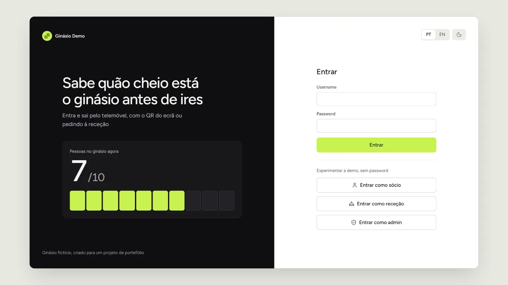
</picture>

## Ecrãs

| Login, com a ocupação ao vivo | Início do sócio |
| --- | --- |
| 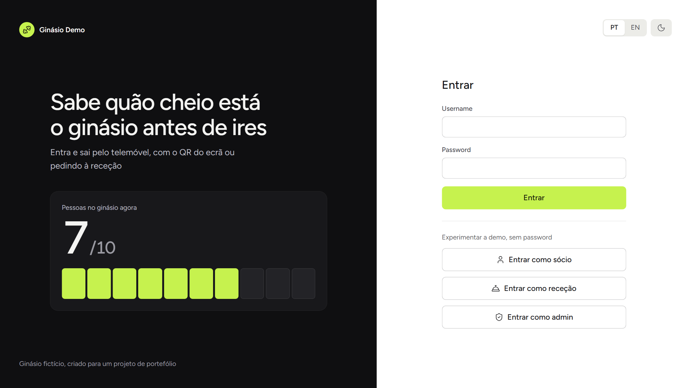 | 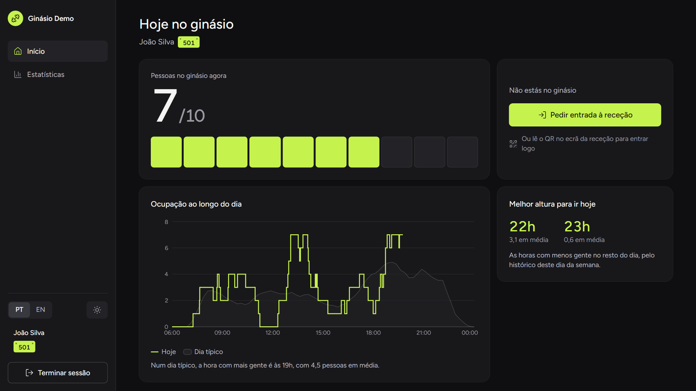 |

| Balcão da receção | Ecrã do QR virado para os sócios |
| --- | --- |
| 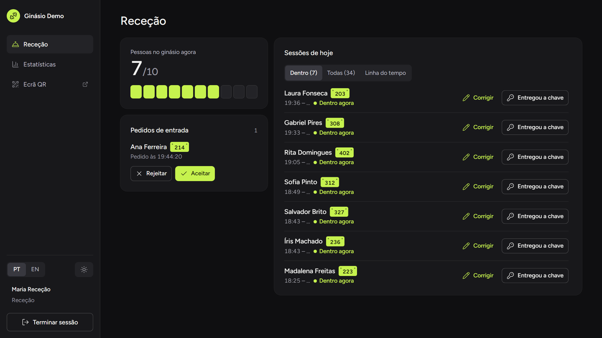 | 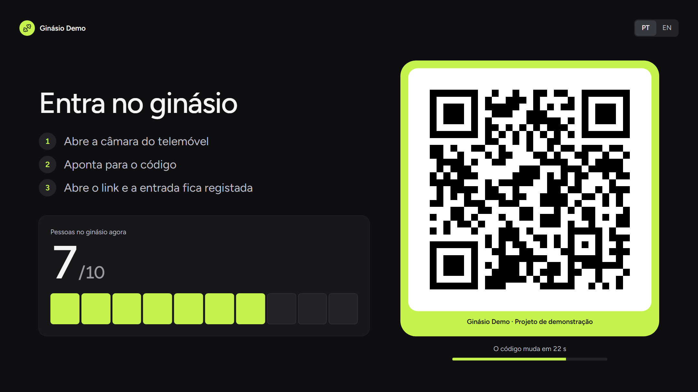 |

| Estatísticas | Contas (admin) |
| --- | --- |
| 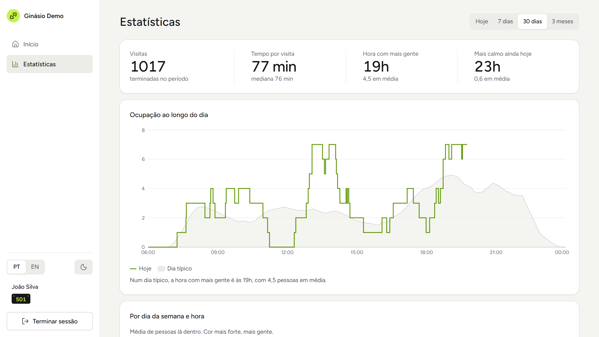 | 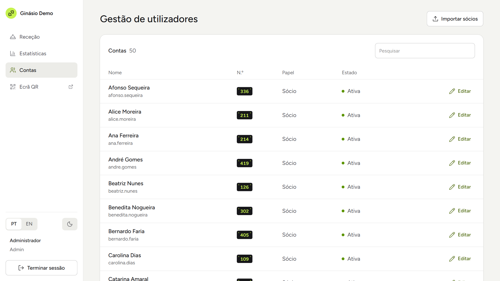 |

| Telemóvel, claro | Telemóvel, escuro | Horas com mais gente |
| --- | --- | --- |
| 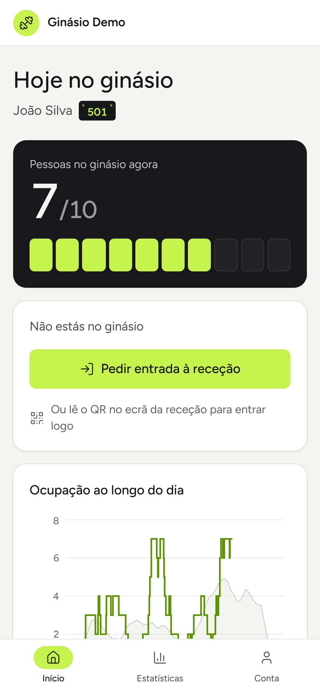 | 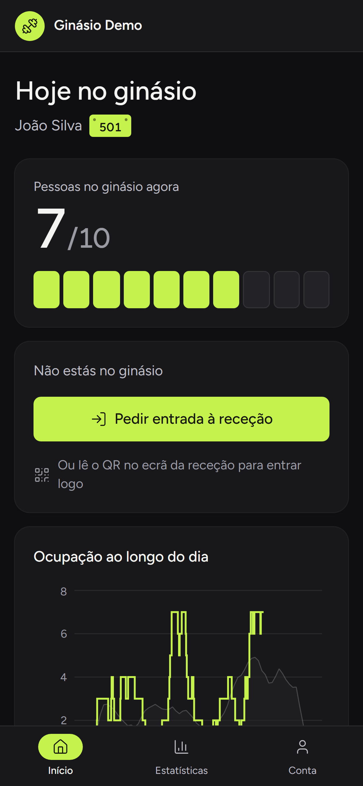 | 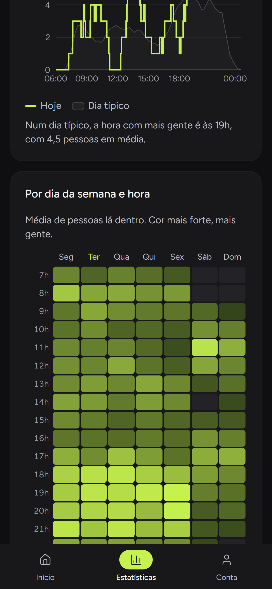 |

## Porquê

No Ginásio Demo, que é fictício, é preciso ir buscar a chave à receção e preencher uma folha em papel. O ginásio é pequeno e não há forma de saber quantas pessoas lá estão antes de chegar. A folha em papel também não serve para estatísticas.

## O que faz

- **Vês quantas pessoas estão no ginásio agora**, em tempo real, no telemóvel.
- **Entras** lendo o QR do ecrã da receção, ou pedindo à receção que te aceite. Uma foto do QR não funciona a partir de casa: o código muda a cada 30 segundos.
- **Sais** com um toque. Quem se esquece de sair é fechado automaticamente.
- **Vês quando está mais calmo**: um dia típico, as horas com mais gente em cada dia da semana e a melhor altura para ir hoje.
- **A receção** aceita pedidos, vê quem está lá dentro e as visitas de hoje numa linha do tempo, e corrige horas erradas, tudo num só ecrã.
- **O admin** importa sócios de um ficheiro CSV e gere as contas.
- **Funciona como uma app** no telemóvel (instalável), em português e inglês, com tema claro e escuro.

## Para quem programa

- **Regras na base de dados:** "uma visita aberta por pessoa" é um índice único, seguro mesmo com dois pedidos ao mesmo tempo.
- **Estatísticas justas:** cada visita conta pelo tempo que a pessoa esteve mesmo lá dentro, na hora de Lisboa, incluindo os dias da mudança de hora.
- **Privacidade desde o desenho:** os sócios só veem contagens, nunca quem lá esteve ([segurança e privacidade](docs/seguranca-e-privacidade.md)).
- **Uma demo sempre viva:** sócios fictícios entram e saem ao longo do dia, com horários calculados só a partir da data, por isso um reinício nunca duplica dados e as contas reais nunca são tocadas.
- **Testado de ponta a ponta:** cada pull request arranca a app inteira em Docker e um browser faz o fluxo principal.
- **Acessível:** áreas de toque grandes, contraste WCAG AA, navegação por teclado, uma story no Storybook para cada parte do ecrã.

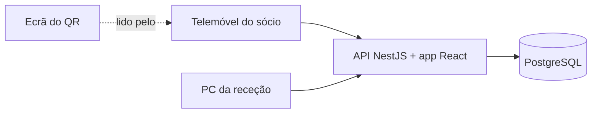

React + Vite + Tailwind, NestJS + Prisma, PostgreSQL, schemas zod partilhados pelos dois, monorepo com pnpm.

## Experimentar no teu computador

Com o [Docker](https://docs.docker.com/get-docker/):

```bash
docker compose up
```

Abre <http://localhost:3000> e entra com as contas acima (admin local: `admin` / `admin-local-only`). Vem com 90 dias de visitas falsas e sócios fictícios a entrar e a sair, por isso a app parece viva e as estatísticas aparecem cheias.

## Desenvolvimento

Requisitos: Node 24 e pnpm.

```bash
pnpm install
pnpm --filter @gym-checkin/shared build
cp apps/api/.env.example apps/api/.env   # preencher DATABASE_URL, JWT_SECRET, QR_SECRET, SEED_*
pnpm --filter api exec prisma migrate deploy
pnpm --filter api db:seed                # as contas acima
pnpm --filter api db:seed-demo           # opcional: 90 dias de visitas falsas (DEMO_MODE=true no .env continua a gerá-las)
pnpm --filter api start:dev              # API: http://localhost:3000/api
pnpm --filter web dev                    # app: http://localhost:5173
```

Verificações: `pnpm lint`, `pnpm test` e `pnpm build` em cada pacote, `pnpm storybook` e `pnpm e2e` em `apps/web`. O CI corre-as em cada pull request.

As imagens acima saem de `pnpm --filter web screenshots` (com a API compilada e o servidor de desenvolvimento do site a correr): mostra sempre o mesmo fim de tarde cheio, por isso podem ser refeitas a qualquer hora.

## Documentação

- [Documentação da API](https://gym-checkin-pjyi.onrender.com/api/docs) (interativa)
- [Segurança e privacidade](docs/seguranca-e-privacidade.md)
- [Roadmap](ROADMAP.md)
